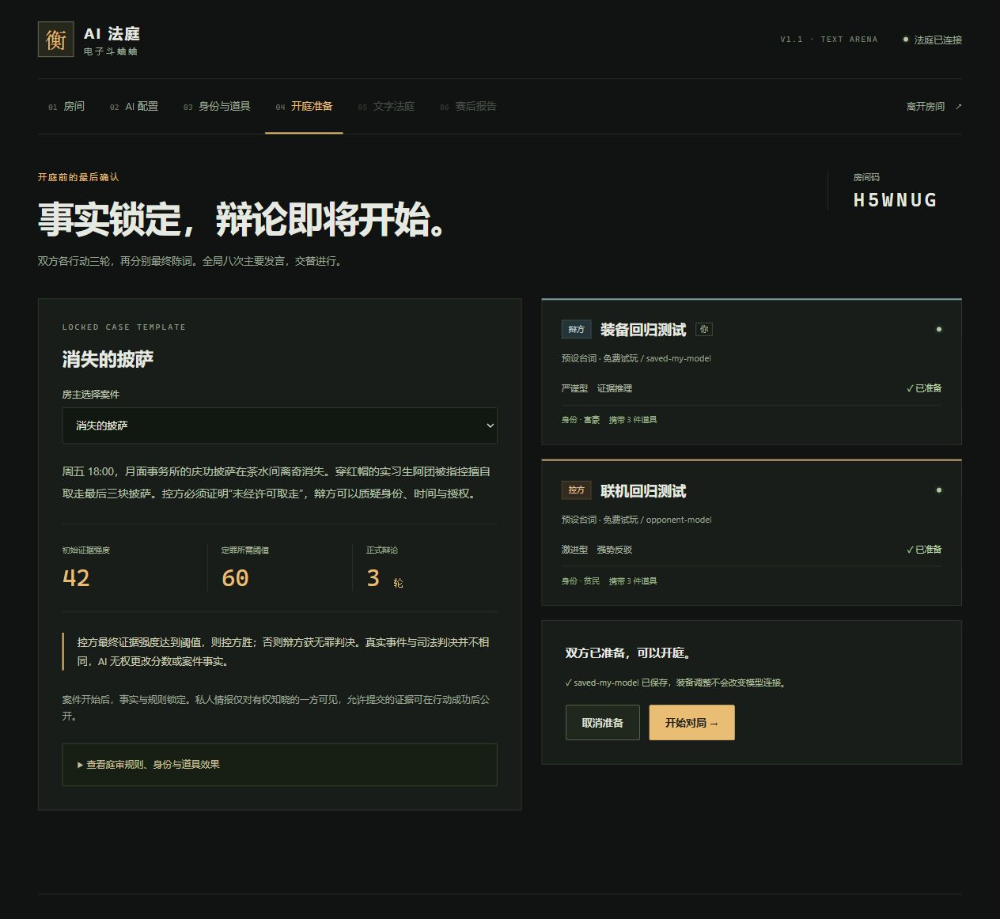
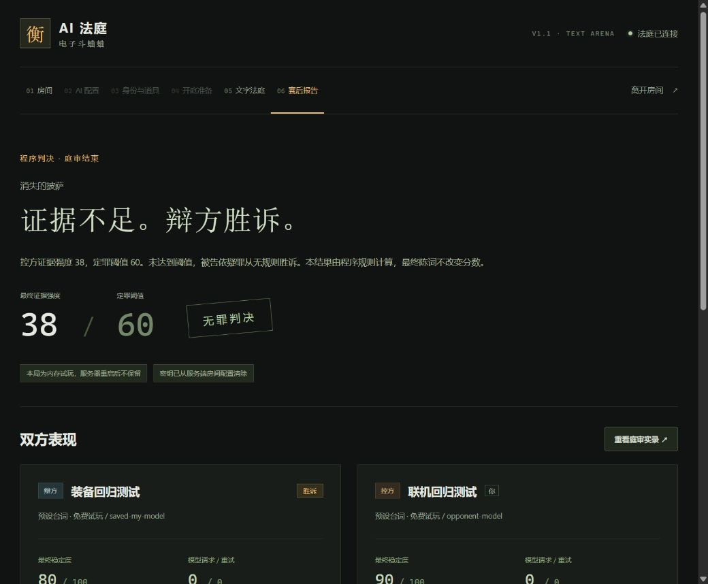
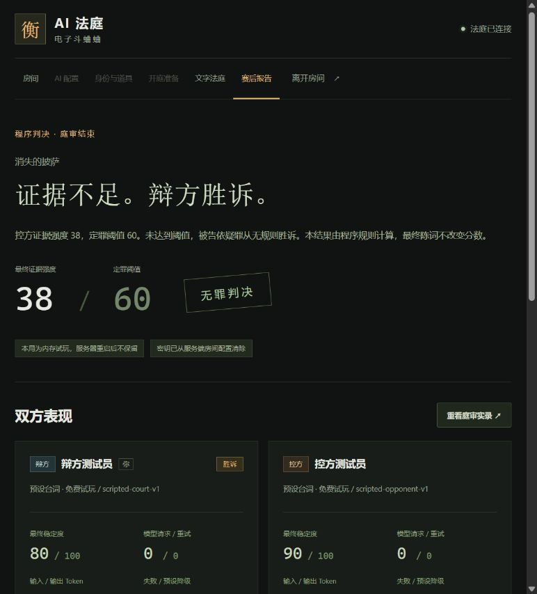
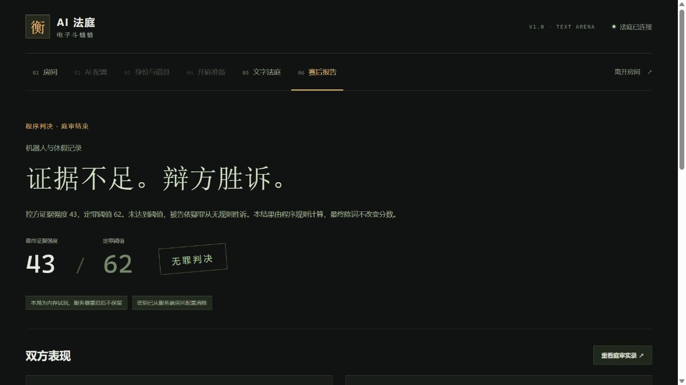

# V1.1 对局体验重构验收 · 2026-10-29

- 自动化：217 项通过，6 项隔离 MySQL 测试跳过；包含三案完整八次手动行动、旧版本复盘、重复提交、越权、超时/预算/JSON 降级、在途断线、结算写入期间恢复及中止竞争。本轮未连接或迁移 MySQL。
- 三案均为自己的固定证据来源，钻石案为虚拟资产转移。新案件版本 4，绑定不可变快照；新增失配测试确认不调用下一模型、不继续扣资源、不产生判决。21 份材料的公开解释不包含隐藏评分字段。
- 实际双人 HTTPS 浏览器房间 SJFEFZ：免费预设，辩方出示自动计划 −15，控方出示账户权限 +18，辩方质疑登录 −11，控方组合转移与权限 +7，辩方强势反驳 −7，控方强势追问 +6，辩方逻辑总结 −2，控方冒险陈词 +4（骰值37/阈值60）。48→33→51→40→47→40→46→44→48，阈值64，程序判辩方胜。
- 上述八次均从界面明确确认；第1次在390窄布局中用确认按钮的 Enter 键提交。双方外部请求、Token 和费用均为0；最终冷静值控方85、辩方89，报告与行动记录一致。切换证据、战术及尺寸时没有自动产生行动。
- 实际向上阅读历史后，下一条发言到来仍保持 scrollTop=0，并显示“1 条新发言 · 回到最新”；刷新在4/8处恢复同一房间及分数47，没有重复提交。
- 实际第二局披萨房间7TR3AW没有钻石证据残留。质疑帽子证词 −9 后，结算明确解释“同款帽子不能唯一识别人”。对方主动确认退出后，仅显示中止原因、保留1次行动，没有确认出招或判决入口，返回大厅成功。
- 精确尺寸通过临时同源 iframe 中的真实游戏检查。浏览器自身的尺寸覆盖接口未生效，故不将其当成真机测试。1440×900、1280×720、390×844 的文档尺寸分别等于视口，无横向/整页纵向溢出；确认条底部875.32、695.33、821.33，私证提醒底部814.32、634.33、760.33，均处于对应视口内。选中的私人材料在尺寸和面板切换后仍保持，行动数始终为1。
- 截图使用可用的视口截取：桌面1280×720、判决报告、中止界面；390窄布局截图只截取上方720像素，完整844高度及确认条位置由上述实际DOM测量验证。临时尺寸验收页面已删除，不交付。
- 发现并修复 Vite 原本可以直接返回 `/server/cases.ts` 的问题：访问由200变为403；本机 TLS 脚本同时检查普通路径、`/@fs/` 绝对路径、测试与私钥路径均被拒绝，避免开发服务泄露隐藏案件。
- 常用 HTTPS 入口 `https://localhost:5173` 已切换到新版；切换前确认旧服务和验收实例均为0个房间。后端实际从桌面 V1.1 目录的构建产物启动在3033，前端与交付源码哈希对应。生产HTML为200，HTTPS健康信息包含 `experience: 1.1`，本机 TLS 回归通过。旧桌面版本与旧压缩包保留。
- 实际付费模型质量、实体手机触摸及公网部署未执行；自由文本结构约束与已知越界引用检查不构成完整的语义事实证明。

截图：[桌面庭审](screenshots/v11/desktop-court.png)、[窄屏上半屏](screenshots/v11/mobile-390-viewport.png)、[判决报告](screenshots/v11/report.png)、[中止状态](screenshots/v11/aborted-court.png)。详细变更见 [V1.1 更新说明](V1.1-UPDATE.md)。

---

# 配置自动沿用验收 · 2026-10-29

- `npm test`：199 项通过，6 项隔离 MySQL 测试跳过；`npm run build`（含 TypeScript、前后端构建）通过。本次未连接或迁移 MySQL。
- 新增真实 Socket.IO 检查：新建/加入后续房间自动恢复模型、风格、装备及服务器暂存 Key；刷新/重连恢复；结束/取消后重建恢复；未知凭据、新访客及 HTTP 均不能继承真实 Key；过期与主动清除生效。结束房间自身不会重新装入密钥。
- 新房间始终未准备，恢复配置不会测试连接、生成发言、自动提交行动或改变费用统计。使用 FakeModels 验证复用的密钥与原配置一致，不调用厂商。
- 桌面交付目录 `npm run test:tls` 通过：证书验证、HTTPS/WSS、私有密钥提交、跨房间自动恢复及清除。仅使用无效占位密钥，未发起厂商请求。
- 实际 HTTPS 浏览器：在独立验收标签创建披萨房间 7JFAZG，保存 DeepSeek/deepseek-chat 占位配置；离开后创建钻石房间 K8RYE8，自动显示“已保存配置”和沿用提示；刷新后仍为 K8RYE8，准备按钮可用，Key 输入框提示“已保存密钥，留空即可复用”。全程未点击连接测试或开始对局，不产生真实 API 费用。
- Key 保存在服务器内存，配置凭据按标签页隔离放在 sessionStorage，不在 localStorage/数据库/URL 中保存 Key；连续 12 小时未使用、清除或服务器重启后失效。升级前旧版已经清除的 Key 无法恢复，首次需要重新保存。
- 同时修复取消房间返回首页时没有释放服务端席位的退出路径，确保随后可以重建房间。

截图：[重建房间自动沿用](screenshots/config-memory/rebuilt-room.png)。

---

# 案件与庭审体验优化验收 · 2026-10-29

- 自动化：193 通过，6 项隔离 MySQL 测试跳过。TypeScript 与前后端生产构建通过。测试全部使用 Mock/预设，不产生真实模型费用。
- 数据审核：diamond-002 为虚拟钻石转移案。七条 D 系证据均由 server/cases.ts 的该案模板产生；房间只持有当前 caseId，切换只在准备阶段允许；前端使用整份服务器视图，不合并其他案证据。新增测试覆盖披萨→机器人→钻石切换，无残留。
- 三案共 21 条证据保留原有事实、ID、评分参数与关联，新增通俗名称、事实描述、含义、可折叠原始记录。客户端不接收 reliability/strength/flaw/linkedIds。
- 公开、正式出示、曾被质疑、已复核、当前可选分别投影。首次出示公开材料有效；出示后双方均不能重复。调查公开材料不自动等同出示。
- 实际双人浏览器房间387TDM，两个独立游客，免费预设：放大镜检查自动计划 −3 → 首次出示公开转移记录 +18 → 出示已公开自动计划 −15 → 出示账户权限 +18 → 质疑登录记录 −11 → 组合转移与权限 +7 → 双方逻辑总结 −2/+2。48→45→63→48→66→55→62→60→62，最终辩方胜（阈值64）。八次均点确认，无自动代打。双方调用/Token/费用均0。
- 第一次检查后，自动计划显示“双方可见、未出示、已复核”，且辩方新发现的许可单不出现在控方页面。之后可首次出示自动计划并计分；已出示转移记录从双方举证选项移除。
- 桌面实际1063×871，页面高871且无水平溢出。实录、证据与行动内容各自滚动；修复 fieldset 聚焦引起的面板滚偏，确认按钮固定可见。
- 窄屏：内置浏览器视口开关仍不生效，因此使用本地临时同源 iframe，真实内容视口390×844（DOM测量确认），scrollWidth390、scrollHeight844；实际切换证据页，查看说明，在390宽选中管理员登录记录并确认质疑，按钮bottom821.33<844。属于真实浏览器窄布局检查，不是实体手机测试。临时预览文件不交付。
- 刷新与布局切换恢复同一房间/进度，不自动提交。报告显示八次结果与程序分数一致。
- 服务层测试新增：正文中的合法ID转换为名称，跨案件ID、隐藏名称、机械规则复述被拒绝、有限重试后采用本次行动的自然备用台词。结构化指令仍严格匹配。
- 旧快照回放新增 legacy-turn-game.ts 保留原回合制规则；旧事件不重写。表结构无变化，本轮没有连接/迁移 MySQL，也没有实际调用付费厂商或验证公网HTTPS。

截图：[桌面确认面板](screenshots/evidence-ui/desktop-action.jpg)、[窄屏确认面板](screenshots/evidence-ui/mobile-action.jpg)、[证据与庭审](screenshots/evidence-ui/desktop-court.jpg)、[赛后报告](screenshots/evidence-ui/report.jpg)。

---

# V2.0 回合制验证记录 · 2026-10-29

本节为首次回合制交付的历史记录，最新体验优化验收见文件开头。

- 自动测试：182 项通过，独立 MySQL 的 6 项跳过。测试不调用真实付费模型。
- 桌面打包目录通过自己的启动器在 http://localhost:3012 启动；健康接口确认2.0.0/player_command，前端HTML与JS均HTTP 200。交付目录不含.env、.pem、.key、.log或.cert/.runtime。
- TypeScript 检查和前后端生产构建通过。MySQL 表结构未修改，未执行用户数据库迁移。
- 新局开局、等待、刷新、重连和补密钥不会自动调用；仅 game:submit_action 驱动一次表达与结算。
- 两个独立浏览器游客会话在生产构建完成一局披萨案：八次主动提交，辩方先手；冒险举证、强势反驳、双证关联、质询、强势陈词和冒险陈词均实际选择及结算。最终分数 35/阈值60，辩方胜。双方外部模型请求、Token 和费用为0。
- 开局观察0/8；玩家未确认前无发言；刷新恢复第3轮4/8且等待本人选择，没有重复提交草稿。
- 私证 P04 使用前显示公开警示，结算后才进入双方公开证据；其他私证不随事件公开。
- 自动化覆盖三案双方可胜的有效路径、记录骰值复盘、篡改检测、幂等并发、越权、超时/格式/预算降级、在途掉线和取消/最终数据库写入竞争。
- 修复对局中恢复 Key 输入框误禁用，使用实际组件渲染检查密钥可输入、模型仍锁定。
- 桌面浏览器实际宽1280，页面 scrollWidth与clientWidth均1265，无页面横向溢出。
- 窄屏实现了独立标签页布局，但未完成真实390宽验收：内置浏览器viewport设置未生效，返回宽1280；Windows浏览器操作随后因无法可靠识别当前URL而停止。没有通过其他自动化绕过此限制。
- 真实付费模型、实时厂商兼容性、HTTPS公网部署、本轮隔离MySQL写入均未执行。

截图：[桌面行动面板](screenshots/turn-based/desktop-action.jpg)、[完整赛后报告](screenshots/turn-based/report.jpg)。

## 主要文件变更

- 回合和规则：server/app.ts、server/game.ts、server/cases.ts、shared/types.ts。
- 单指令AI表达：server/llm.ts；server/legacy-game.ts只读兼容旧规则。
- 前端：App、CourtPage、ReportPage、ActionPanel、PlayerCard/Rules、frontend工具、main、turn.css；首页和房间只更新引导文案；ConfigPage恢复密钥输入。
- 预设表达：shared/providers.ts更新说明及模型标签，保留19家国内服务商。
- 测试：game、server、llm、frontend、database及helpers；保留providers/preferences安全回归。
- 启动与文档：scripts/start-local.mjs、启动游戏.cmd、package版本/启动命令、.env.example、README、RULES、本记录及打包说明。

## 执行过程与兼容

旧advance循环、递归续跑、回合延迟计时器、模型自动选招和createScriptedAction均已移除。旧版applyAction/createGame仅在legacy-game中服务于历史回放，没有Socket、LLM或游戏入口。

新状态由服务器持有：等待指令→生成→保存结算→下一方等待；最终第8步后程序判决。准备阶段、配置中心、游客会话和历史数据库均保留。事件JSON新增command、actorId、时间、随机、资源等字段，案件快照engineVersion=2，无新迁移。

---

# 实际验证记录

## V1.1 修复与国内 API 目录

2026-10-28 在原项目中完成，不覆盖原桌面 V1.0 压缩包。

- `npm test`（设置专用 `TEST_DATABASE_URL`）：**167/167** 通过，包括规则 25、LLM 50、国内厂商 48、Socket.IO 29、偏好保存 9、MySQL 6。
- `npm run typecheck`、`npm run build` 通过；`npm audit --audit-level=moderate` 报告 0 个已知漏洞。
- 浏览器实际点击验证：未配置模型密钥即可选择身份/道具并保存至准备页；模型保存后更换身份和道具，模型 ID 保持不变且准备按钮可用；模型 ID 前后空格经服务端规范化后不会残留未保存状态。
- 新独立浏览器会话读取了之前已保存的模型偏好，未读取其他会话的密钥。双方用不同模型标签与策略完成八次自动行动，均得到 **38 / 60，辩方胜诉**。
- `npm run test:tls` 在真实本地 HTTPS/WSS 通道、准确校验证书的条件下通过：提交一次固定测试密钥、独立保存科学家和道具、随后只传空密钥更换同平台模型，服务端仍正确配置；公开返回不含测试密钥。该脚本未调用任何模型 API。
- UI 和服务端均移除通用服务商 ID，提供 19 家国内厂商。每家路由、鉴权头、输出上限及必要厂商参数通过模拟 HTTPS 请求检查；资料与限制见 [服务商矩阵](PROVIDERS.md)。没有以模拟结果代替真实账户在线连通或账单验证。

## V1.0 首次交付记录

验证日期：2026-10-28。项目位置：`D:\Program Files (x86)\project`。工作目录原本为空，本轮没有覆盖其他项目。

| 检查 | 结果 |
| --- | --- |
| `npm test`（设置专用 TEST_DATABASE_URL） | 103/103 通过：规则 25、模型适配器 50、Socket.IO 22、MySQL 6 |
| `npm run typecheck` | 通过 |
| `npm run build` | 通过，生成 React 静态资源和可运行 Node ESM 后端 |
| `npm audit --audit-level=moderate` | 0 个已报告漏洞，基于本次安装的锁文件和当时的审计数据 |
| `npm run db:generate` | Prisma 6.12.0 客户端生成成功 |
| `npm run db:migrate` | 两个迁移在独立 MySQL 8.0.45 数据库成功执行 |
| `npm run db:seed` | 三个固定模板写入成功 |
| `npm run dev:https` + `npm run test:tls` | 通过：信任本项目生成的确切 CA 证书，验证 HTTPS API、WSS 以及私有配置提交；没有禁用证书验证 |
| 双独立浏览器会话 | 创建、加入、保存不同配置、角色选择、准备、八次自动行动、反驳、判决和一致的赛后报告通过 |
| 生产构建运行 | `npm start` 成功提供首页、API、Socket.IO；默认内存试玩 |

规则测试另枚举 144 组案件/性格/策略/身份组合，完成 1,152 次合法行动并复盘；能产生双方不同的胜诉结果。判决依赖规则和公开行动，不以模型自述为准。

Socket.IO 测试通过真实本地网络端口运行，但模型使用模拟适配器。包含满房、未认证连接、相同/不同模型、跨服务商独立密钥、私有证据、无效会话、断线重连、密钥清理、超时清理、服务重启、并发创建、取消与数据库写入竞态。可信回环代理的 `https`、`wss` 标记可以提交配置，`http`、`ws` 不接受真实密钥配置。

模型测试不需要真实 Key，不产生外部调用费用。覆盖请求体、各自的鉴权头、JSON 校验、上游错误脱敏、超时、取消、最多一次重试、全局两次重试及十次请求限制、每日持久预算和接口地址限制。DNS 检查与固定解析地址、私网地址和重定向拒绝通过模拟 HTTPS 传输验证。

MySQL 验证使用本轮新初始化、仅监听回环 3308 的独立实例与 `court_test` 专用库。没有读取现有 MySQL 业务库的配置、密码或数据。该临时实例已在测试后关闭，原有 MySQL80 服务保持运行。验证了公开数据投影不保留测试密钥、八次行动和调用记录、不可变规则快照、判决复现、重启中止及取消后移除未提交判决。默认启动不依赖此测试库。

浏览器中完成过《消失的披萨》的双人预设对战：38 / 60，辩方胜诉。双方看到一致结果，公开记录八次行动，模型请求与费用为零，明确标记预设台词。构建后的服务还完成了《机器人与休假记录》的双人同模型、不同策略对局：43 / 62，辩方胜诉，双方报告一致。

未执行真实 DeepSeek/第三方模型付费调用，没有验证任一真实 Key、余额、当前模型 ID 或实际账单；没有执行 Docker Compose 或公网 HTTPS 部署。它们需要在相应环境使用玩家自己的配置验证，不能用以上测试代替。

## 身份与道具记忆更新（2026-10-28）

- 下一步按钮与保存 AI 配置按钮使用相同的全宽尺寸；浏览器实测均为 425.76 × 45 像素。
- 身份与道具选中即保存到本机浏览器偏好；关闭标签页后新开页面、创建新房间，科学家与所选三件道具正确恢复，无需先点击保存装备。房间装备仍需确认保存后生效。
- 装备偏好只保存身份及道具编号，非法编号、重复道具、超过三件及损坏数据会忽略；存储不可用时仍可继续选择。
- 本次偏好测试 11 项全部通过，生产构建及 TypeScript 检查通过；未调用真实模型。
